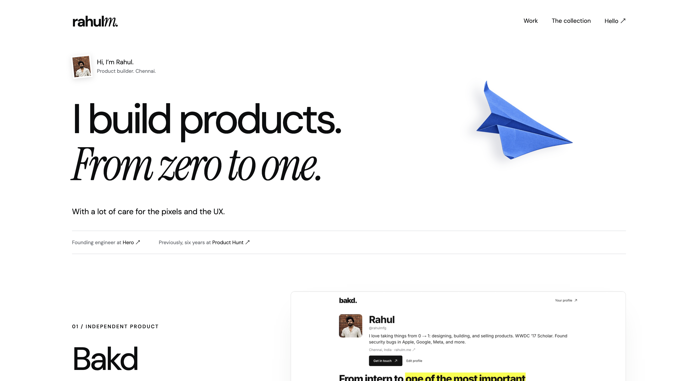
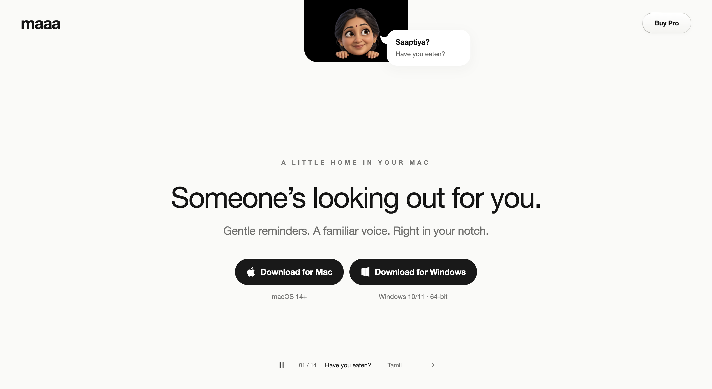
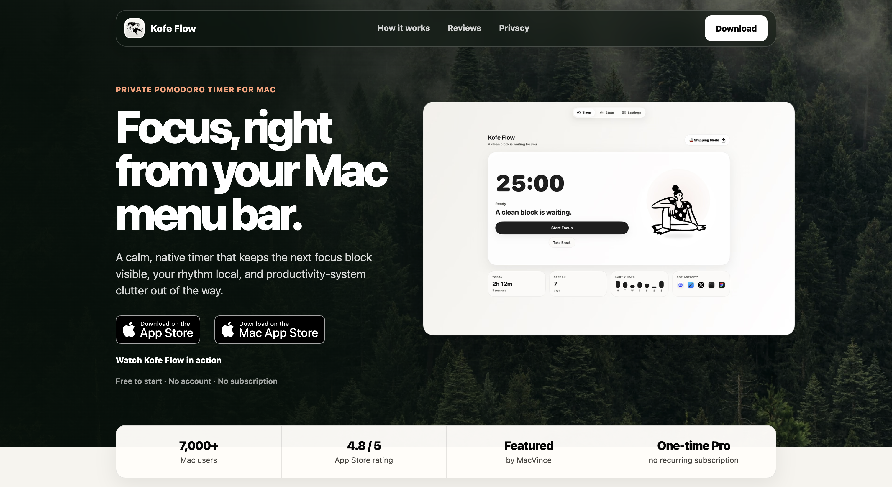

# Design Skill

A reference-first design skill for Codex: choose a direction together, build it faithfully, and make the result easy to use.

For websites, apps, screens, and interactive prototypes. Small styling fixes use only the relevant quality checks.

## What it does

1. **Show references first.** Review existing websites or UI images inline, with source links and a reason for each reference.
2. **Choose one thing at a time.** Start with three distinct layout options, explain their tradeoffs, and let the user choose before substantial implementation.
3. **Remember the choices.** Carry approved and rejected decisions into the specification, build, and review.
4. **Keep screens focused.** Give focused tasks one clear primary action, concise copy, and optional detail revealed when needed.
5. **Make every element useful.** Avoid unnecessary cards, pills, badges, gradients, invented metrics, and decoration.
6. **Verify the actual result.** Compare rendered screenshots with the approved direction across screen sizes and check interaction states and accessibility.

The workflow adapts to **Explore**, **Refine**, or **Ship**. An approved design does not need another round of alternatives. A useful dashboard does not need to become a one-button screen.

## Visual references

These examples were made with an earlier version of the skill, as shared in [Rahul's original post](https://x.com/rahulmfg/status/2112230521417949192). They show different ways to give a design character:

| Rahul's portfolio | Maaa | Kofe Flow |
| --- | --- | --- |
|  |  |  |
| Typography and whitespace | A focused message and character | Atmosphere and product context |

See the [full-size references and design notes](references/visual-examples.md) for what to learn from each and what to reconsider. These are examples, not fixed templates or proof that every layout choice is ideal.

## Install for Codex

Clone the repository into your skills directory:

```sh
git clone https://github.com/Getmrahul/design-skill.git \
  "${CODEX_HOME:-$HOME/.codex}/skills/design-skill"
```

If that destination already exists, review it before replacing or updating it.

Then invoke the skill:

```text
Use $design-skill to design this screen. Start with visual references,
show three layout options, and help me choose one before building.
```

For an existing direction:

```text
Use $design-skill in Refine mode. Keep the approved layout.
Simplify the screen so the main action is obvious and optional details
appear only when needed.
```

## Use as a project playbook

Copy this repository's `SKILL.md` and `references/` into a folder such as `docs/design-skill/` in your project. Add this instruction to the project's `AGENTS.md`:

> For design or substantial UI implementation tasks, read and follow `docs/design-skill/SKILL.md`. For minor CSS or component fixes, apply only the relevant quality and verification rules. Preserve the project's brand, design system, and approved decisions.

## Contents

- [SKILL.md](SKILL.md) — the complete design workflow.
- [Simplicity examples](references/simplicity.md) — practical guidance for reducing overload without adding friction.
- [Visual examples](references/visual-examples.md) — three supplied screenshots with strengths, tradeoffs, and source context.

## Origin

Evolved from Rahul's [Codex Design Playbook gist](https://gist.github.com/Getmrahul/7874e4aa5e1aaec63eb72caad9dccf94), an original Codex-oriented adaptation of Anshu Chimala's [*How to turn your AI into a world-class designer*](https://www.lennysnewsletter.com/p/how-to-turn-your-ai-into-a-world).

This version adds reference previews, staged design choices, a decision record, and guidance for focused screens and progressive disclosure.
